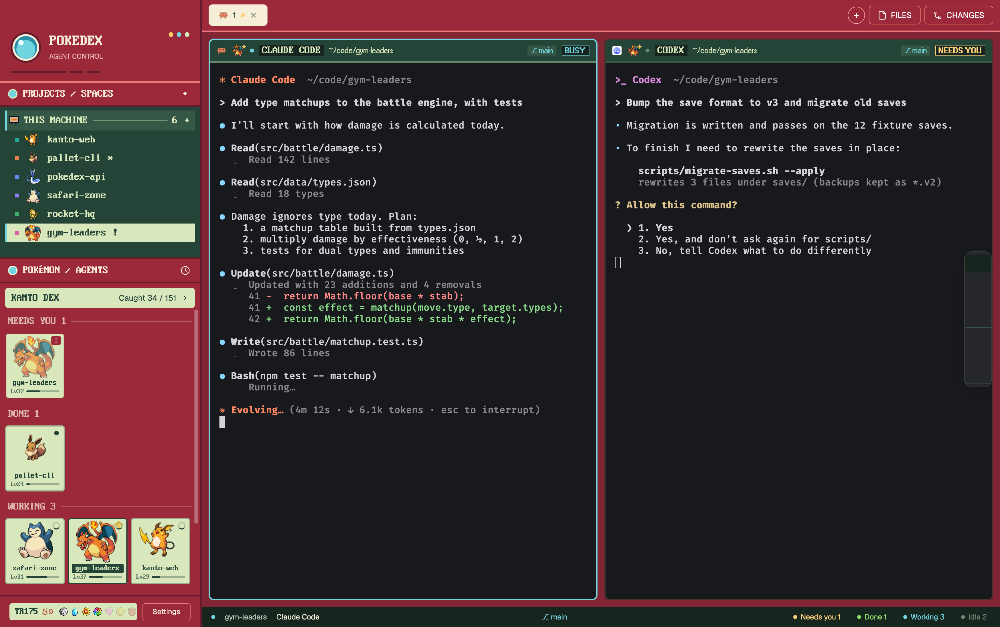
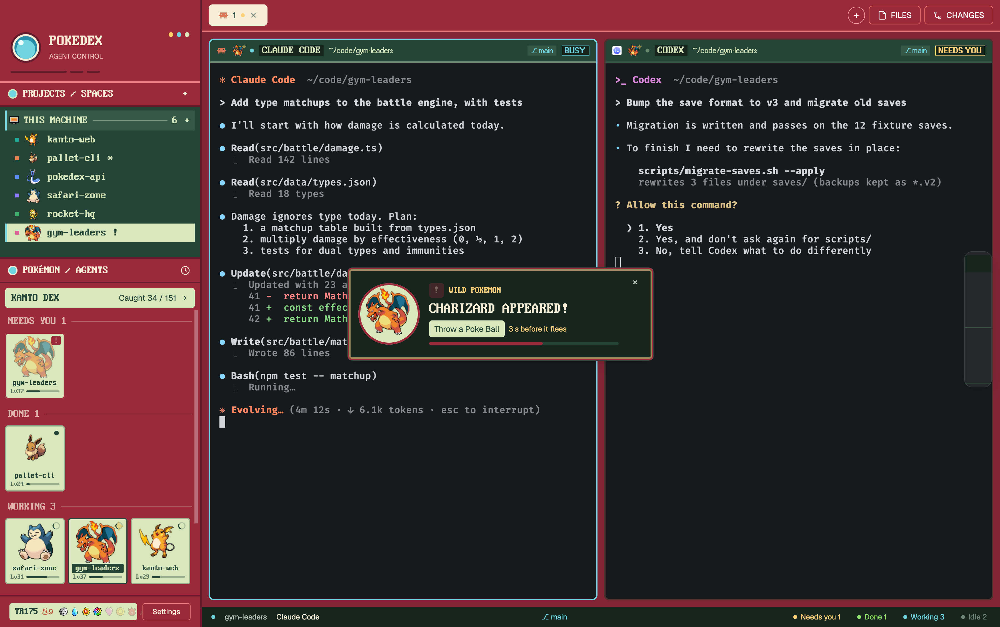
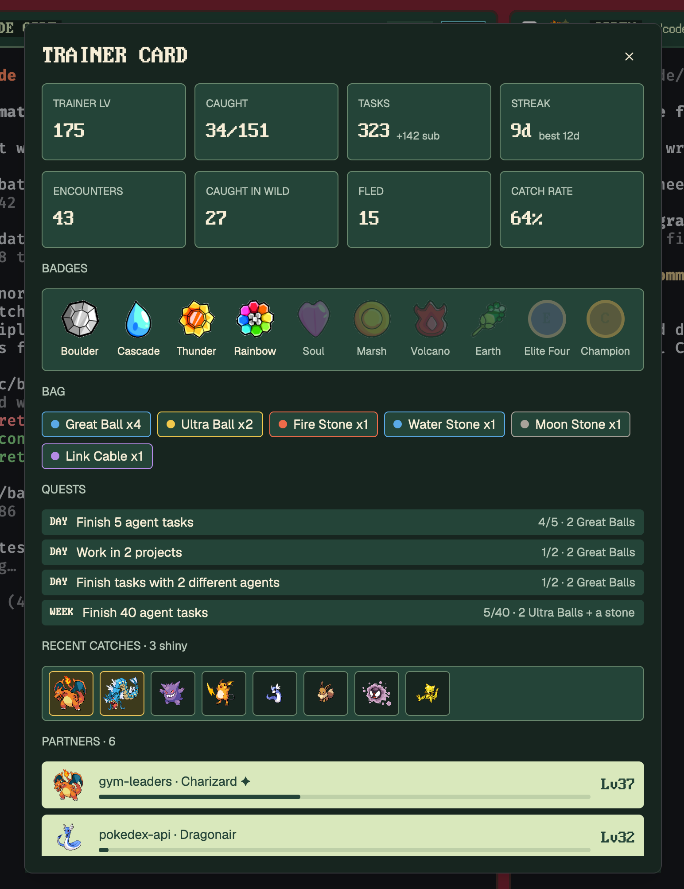

# pokemon-herdr: Gotta Ship 'Em All

**A [Herdr](https://herdr.dev) layout where every coding agent is a Pokémon, every project has a mascot, and finishing work is how you raise your party and fill the Pokédex.**



`pokedex` turns a wall of terminals and agents into a red Kanto Pokédex, then quietly turns the workday into a game.

The screenshots are native Herdr captures of a staged window: demo projects, scripted agents, no real work.

No agent finishes a task without something happening. XP lands. Your lead levels up. Sometimes a wild Snorlax turns up in the tall grass and waits there until you have a moment.

---

## The 30-second tour

Everything in the screenshot above, region by region:

| Where | What it is |
|---|---|
| **Top left** | The Pokédex lens and the brand plate. Drag it to move the window. |
| **Projects / Spaces** | Every space, with its mascot Pokémon beside its name. |
| **Pokémon / Agents** | Every agent as a sprite on a pale LCD card: working, needs you, done, idle. Tiles, or cards with sub-agents. |
| **Footer** | Trainer level, streak, and the badges you've earned (or what waits for you: your starter, a gift). Click for the trainer card. |
| **Right edge** | The alerts drawer. It peeks out as status dots; hover and it slides open with Jump, Peek and Pin. |
| **Status bar** | The focused folder's git state, the tall grass (wild Pokémon waiting), your alert and hard mode settings, and a count of who's working. |

The layout is named **pokedex**. It works with any agent that reports its status to Herdr: Claude Code, Codex, OMP, OMO and others. Agents that don't report still work as ordinary terminals.

---

## The game

It runs on real work: XP, items and wild Pokémon all come from agents finishing tasks.

### Your party and XP

You start by choosing **Bulbasaur, Charmander or Squirtle** on the trainer card (the footer says "Choose your starter"; XP earned before that waits for it). After that you have **one party** of up to **6** Pokémon from your Pokédex. The first one is your **lead**: every XP your agents earn goes to it, whichever project they work in. The rest of the party sits in the **Day Care** and gets **25%** of it. Change the lead or the party from the trainer card.

- **10 XP** per finished turn, **+5 per minute** it ran, capped at **50**
- A turn's results pay on top: **+20** when the agent committed (Herdr checks the repo's HEAD before and after the turn), **+30** for green tests, **+50 and an Ultra Ball** for a merge. Herdr reports commits only; green and merged come from other clients.
- **10 XP** for each finished sub-agent
- **Daily diminishing returns**, the same in 1 repo or 10: the day's turns 1-5 pay in full, 6-20 pay 40%, 21-50 pay 10%, then 3%
- **Rested XP** for time away: each day off beyond the two a week a streak allows banks one day of your own average XP, up to three days of it, and XP counts **double** until the bank is spent. A normal weekend banks nothing, so a weekend off costs you nothing and a holiday gives you a running start.
- Level *n* costs `4 × n²` XP, so Lv16 is 1,024 XP and Lv100 is 40,000

Party Pokémon **evolve at their real Gen 1 levels** and keep their XP. Charmander becomes Charmeleon at 16. Dratini makes you wait until 30, then 55. Magikarp is still Magikarp until 20.

Stone and trade evolutions need the item: Fire, Water, Thunder, Leaf and Moon Stones, and a **Link Cable** for the four that used to need a friend. Use them on a party member from the trainer card.

### Mascots

Every project still shows a Pokémon on its cards: its **mascot**. It's for show only. Click a card's Pokémon to pick another one from your catches.

### Trainer level and gifts

Your **trainer level** comes from all the XP you've ever earned: level *n* starts at `40 × n²`. Gifts arrive at trainer levels **5** (Eevee), **10** (Lapras), **15** (Omanyte or Kabuto, your choice), **20** (Hitmonlee or Hitmonchan) and **30** (Porygon). A gift with a choice waits on the trainer card.

A save from before the party moves over by itself: each project's partner joins the Pokédex with that project's XP, the six with the most XP form the party, and the trainer card explains the change once.

### Wild encounters

Every finished task has a **15% chance** of a wild Pokémon. It hides in the **tall grass** and waits there for **24 hours**; the grass holds up to **5**, and no new one shows up while it's full.

Nothing pops up by itself (unless you ask for it, see Settings). The status bar shows **Tall grass 3/5**; click it to open the encounter, pick which Pokémon to throw at, and go.



- You get **3 free Poké Balls** per encounter, then any Poké Balls in your bag. Great Balls (×1.5) and Ultra Balls (×2) come from the bag too.
- Base catch odds: **60%** for most, **35%** for final evolutions and for legendaries, which come from milestones (a bird for three weekly quests in a row, Mewtwo for the Champion, Mew after the other 150) and wait until caught. 40% of wild Pokémon are species you don't have yet.
- **Keep working and it weakens.** Each task finished while it waits adds +25% to your odds, up to three times.
- Ignore it for a day and it flees.

### Don't leave them waiting

Answer an agent stuck on **NEEDS YOU** inside **2 minutes** and its project's next task earns **+25% XP**, and it counts toward a quest.

In **hard mode** an agent left on NEEDS YOU for **10 minutes** makes its mascot **faint**: that project's next task earns no XP while it recovers. Hard mode is off by default.

### Settings

Both live in the status bar; click to change them. They are saved by the server, so pokemon-rex sees them too.

| Setting | Values |
|---|---|
| **Alert** | `smart` (default): a new wild Pokémon flashes its battle card only while no agent is working. `on`: always. `off`: never. |
| **Hard mode** | `off` (default) or `on` (fainting, above). |

The same as commands, for `keys.json` or `herdr-app do`: `pokedex-console.alert-off`, `.alert-on`, `.alert-smart`, `.hard-mode-on`, `.hard-mode-off`.

### Loot

| How | What you get |
|---|---|
| First task of the day | a Great Ball |
| Every 7 streak days | an Ultra Ball |
| A task that ran 10+ minutes | a Great Ball |
| A task that ran an hour | a Link Cable |
| Any task, 5% of the time | a random stone |
| A daily quest: Bronze, then Silver, then Gold | a Great Ball, then 2, then an Ultra Ball and 50 PokéDollars |
| The weekly quest: Bronze, Silver, Gold | an Ultra Ball each, plus a stone at Silver and 200 PokéDollars at Gold |
| Professor Oak's five first steps | 5 Poké Balls |

### Quests sized to you

Three daily quests (one of them always a task quest) and one weekly. Each has **Bronze, Silver and Gold** at **50%, 100% and 150% of your own median** over the past two weeks, never below a floor: a quiet week asks less of you, a heavy one asks more, so a casual player and someone running ten repos are set the same kind of challenge.

A quest is only offered when your **last 30 days** show you can do it, so you are never asked for two repos or two agents you don't use. One daily quest that hasn't paid yet can be **rerolled** once a day, with the button on the trainer card.

### Streaks, freezes and shinies

The streak counts **days, not amount**: a day keeps it when **5 of the 7 days** ending with it were active, so any two days off a week are fine, whether or not they're the weekend. A **Streak Freeze** arrives every 7 active days (2 at most) and spends itself on a missing day that would otherwise break the streak; the trainer card shows how many you hold.

Hold a **7-day streak** and new catches have a 1-in-8 chance of being **shiny**; at **30 days** it's 1 in 4. Shinies twinkle with a gold star in the pane header.

### Badges

Eight gyms, one open at a time, in order. Each one counts from the day it opens, and any one way beats it. Counts marked *(your pace)* ask for a few days of your own median, never less than shown, so a heavy week asks more of a heavy user.

| Gym | Beat it by |
|---|---|
| Brock · Boulder | Being active on 5 days |
| Misty · Cascade | Answering 10 blocked agents within 2 minutes, **or** 12 blocked agents *(your pace)* |
| Lt. Surge · Thunder | 10 commits, **or** 10 tasks with green tests or CI *(your pace)* |
| Erika · Rainbow | 3 branches, agents or repos in one day, **or** 2+ of them on 5 days |
| Koga · Soul | Silver on 10 daily quests, **or** Gold on 4 |
| Sabrina · Marsh | 3 merged MRs, **or** 5 tasks that ran 10+ minutes *(your pace)* |
| Blaine · Volcano | An 8-week streak, **or** 30 active days |
| Giovanni · Earth | A Pokémon at Lv 50 and 100 caught, **or** Lv 50 and 30 caught while his gym is open |
| *Elite Four* | After the 8th badge, one member a week: Lorelei (Silver on 3 daily quests), Bruno (3 fast answers, 5 commits or 5 answers), Agatha (2+ branches, agents or repos on 2 days), Lance (the weekly quest at Silver, or Silver on 6 daily quests). A short week is tried again the next one. |
| *Champion* | Beating Lance: your team enters the Hall of Fame, and Mewtwo appears |

Task counts are side medals, never required: Rookie (50 tasks), Veteran (500), Marathon (1,000). Badges earned before the gyms stay as **Classic** medals, and each gives its gym a 50% head start.

### The trainer card and the Kanto Dex

Click the footer for your **trainer card**: your trainer level and totals first, then today's quests with the tier you've reached and a Reroll button, your party (lead, Day Care, XP, stones), badges, your bag with your PokéDollars and any Rested XP waiting, and your recent catches. Your starter choice, waiting gifts and, on a new save, Professor Oak's five first steps sit at the top until they're done.



Click **Kanto Dex** in the agents list for all 151. Your catches are lit, the ones you're missing stay dim but searchable, shinies get a gold mark, and you can search by name or number.


---

## Keys

`keys.json` here holds only a `layout:pokedex` section, so these apply while the Pokédex is showing:

| Key | Does |
|---|---|
| `cmd-p`, `cmd-s`, `ctrl-a a` | the picker: jump to any tab, each space with its Pokémon |
| `cmd-j` | jump to the agent that needs you most |
| `cmd-shift-j` | peek at it without leaving |
| `cmd-shift-k` | pin or unpin the focused agent |
| `cmd-e` | flip between your tabs and one agent, full size |

Merge that section into your own `keys.json`, and change the picker keys if yours differ. On Linux and Windows there is no `cmd`: pick free `ctrl-shift` keys instead (for example `ctrl-shift-y` for the picker, `ctrl-shift-u` / `ctrl-shift-i` for the agent jump and peek), avoiding the plain `ctrl` letters your shell uses.

Also: the blue lens opens the command palette, a Pokémon portrait changes that project's mascot, and the sidebar folds down to a 76px rail.

---

## What's in the box

- **The layout:** `layouts/pokedex.json` and its settings preview, with the look baked in (housing red `#9b293a`, LCD `#d9e8bc`, lens cyan `#71d5df`).
- **Eleven mods** (`mods/pokedex-*`):

| Mod | Role |
|---|---|
| `pokedex-console` | brand plate, trainer footer, status bar |
| `pokedex-spaces` | the projects list |
| `pokedex-agents` | the agent cards, and the source copy of the game's rules (`game.js`) |
| `pokedex-tabs` | the tab bar and the Files / Changes buttons |
| `pokedex-pane` | each pane's header |
| `pokedex-alerts` | the drawer on the right edge |
| `pokedex-picker` | the tab picker, a clone of Herdr's |
| `pokedex-collection` | the Kanto Dex: all 151, searchable; pick a mascot or your party |
| `pokedex-trainer` | the trainer card: starter, party, gifts, stats, badges, bag, quests, recent catches |
| `pokedex-encounter` | the battle dialog: the tall grass, pick one and throw |
| `pokedex-toast` | notifications, and the wild-encounter flash (only when your alert setting allows it) |

- **151 Gen 1 sprites and names**, pixel fonts with their license notices, and short original chiptune jingles for evolutions and badges (silent when Herdr's sounds are off).
- **`programs.json`** with OMP and OMO launcher entries and their icon.

Herdr's shipped `files`, `changes`, `menu`, `new-menu`, `worktree` and
`workspace-chrome` mods remain dependencies supplied by Herdr.
This is a layout package, not the Herdr application source.

Your progress is kept by the Pokedex agents server, in `~/.local/state/pokedex-agents-server/`, never in this repo. Herdr's `shared.json` holds a copy that the server keeps current. Agents count only while Herdr is open. Progress follows each project's git repo, so renaming a space keeps its partner and XP. The first time Herdr connects, it merges any progress it saved on its own before this into the server's save, once.

**Your project names stay on your machine.** The save keys each project by a hash, so it holds no repo path, machine name, space name or branch name. The readable names live beside it in `local.json`, which the server sends to the mods so cards still read `eot-app`, and which no export, import or merge ever carries.

**Nothing is lost when the server is down.** Each report carries the moment it happened; one the server can't take waits in this layout's local storage and goes out, oldest first, once it answers again, counted on its own day. Today's quests and your live streak come computed from the server, so the mods draw what it decides rather than their own copy of the rules, and the footer says to run `scripts/sync-game.sh` when its rules version differs from theirs.

Want to build it from an empty folder instead? [RECIPE.md](RECIPE.md) is the brief.

---

## Install

You need [Bun](https://bun.sh) and the [Pokedex agents server](https://github.com/anthonymq/pokedex-agents-server), which holds the game and your progress:

```sh
git clone https://github.com/anthonymq/pokedex-agents-server.git ~/.local/share/pokedex-agents-server
```

Herdr starts it when it isn't running. [pokemon-rex](https://github.com/anthonymq/pokemon-rex) uses the same server, so both apps play one save.

Use a current Herdr installation. Copy `layouts/`, `mods/` and
`personal-icons/` into your Herdr app home, normally `~/.config/herdr-app`.
Check for existing names first; do not overwrite your own modified files.

Merge the `programs` entries from this repository's `programs.json` into your
existing file instead of replacing it. OMP and OMO must be installed as
`omp` and `omo` for their launcher choices to be enabled. Claude Code and
Codex use Herdr's built-in entries; Codex retains `--no-daemon`.
Personal settings are not included. `keys.json` holds only a `layout:pokedex`
section that opens `pokedex-picker` (Herdr's tab and space picker, cloned to show
each space's Pokemon) on cmd-P, cmd-S and ctrl-A A while the pokedex layout is
shown, plus the alert drawer's keys: cmd-E flips the work area to one full-size
agent and back, cmd-J jumps to the agent that most needs you, cmd-shift-J peeks
at it and cmd-shift-K pins the focused agent. Merge that section into your own
`keys.json` and change the keys to your picker keys if they differ.

The Projects mod runs `git` and `hc` and watches Git metadata outside its own
folder. For remote spaces, those commands run on the space's machine through
Herdr. The agent menu starts the program you select using Herdr's launcher.

Validate the mods:

```sh
(
  for mod in pokedex-console pokedex-spaces pokedex-agents pokedex-tabs pokedex-pane pokedex-collection pokedex-trainer pokedex-encounter pokedex-toast pokedex-picker; do
    herdr-app check "$HOME/.config/herdr-app/mods/$mod" || exit 1
  done
) && herdr-app do layout.switch --name pokedex
```

To return to Herdr's default layout:

```sh
herdr-app do layout.switch --name main
```

The copied [mod usage guide](mods/pokedex-console/README.md) also mentions
`retro-workspace`, the original machine's personal layout. That layout is
not part of this package; use an installed layout name on your own machine.

## Develop

The game rules and their tests live in
[pokedex-agents-server](https://github.com/anthonymq/pokedex-agents-server); only it changes the game.
The mods keep copies of its `game.js` and `pokemon.js` for read-only helpers, and of
`mods/pokedex-agents/server.js`, the client. `scripts/sync-game.sh` refreshes every copy (it
looks for the server repo in `$POKEDEX_SERVER_DIR`, else `../pokedex-agents-server`).
GitHub Actions runs `scripts/sync-game.sh --check` on every push.

## Validation

The source layout was checked in running Herdr at full and compact sidebar
widths. `herdr-app check` validates initial rendering, not every deferred
state or pointer interaction; inspect the running app after installation.
Generated `.d.ts` and `jsconfig.json` files, runtime state, caches and private
terminal screenshots are deliberately excluded; the images in `docs/` are staged.

## Credits

Several custom mods were cloned from Herdr's shipped mods and retain their
source attribution headers. See [NOTICE.md](NOTICE.md) and the included
inherited source license. Font terms are included under
`mods/pokedex-spaces/fonts/`. Pokémon sprites were copied unchanged from the
existing personal setup; this repository does not grant rights to Pokémon
names or artwork.

Design details: [DESIGN.md](mods/pokedex-console/DESIGN.md).
