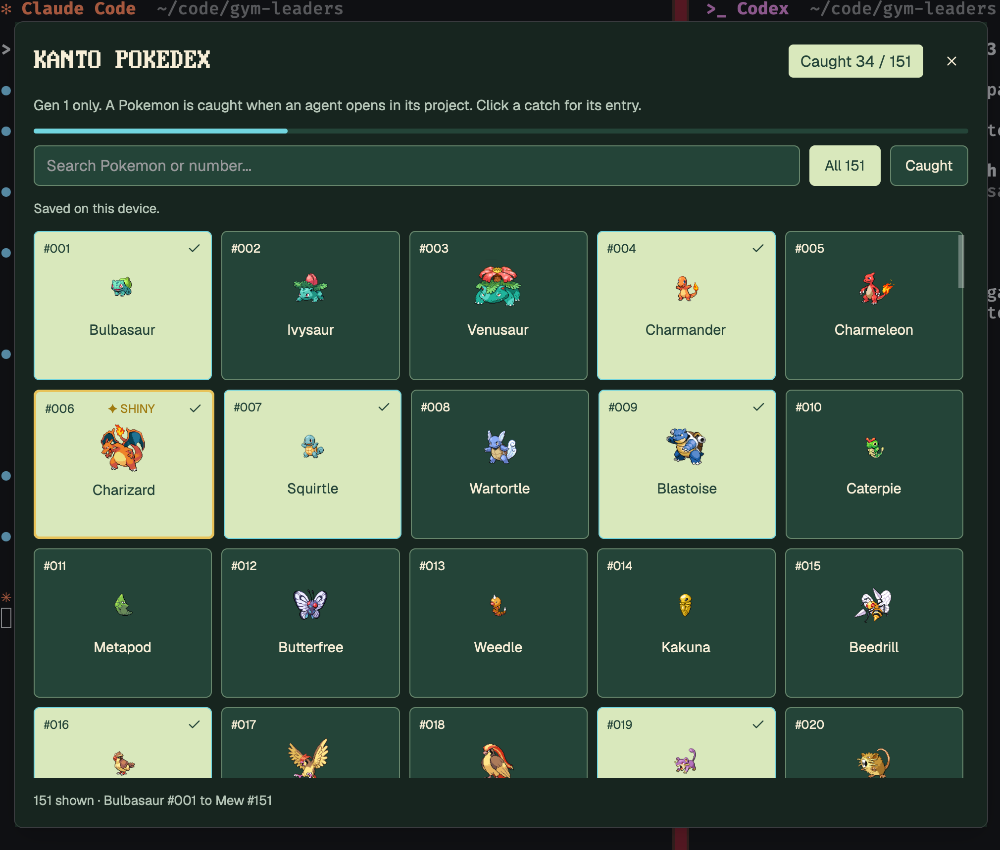

# pokemon-herdr: Gotta Ship 'Em All

**A [Herdr](https://herdr.dev) layout where every coding agent is a Pokémon, every project has a partner, and finishing work is how you fill the Pokédex.**


`pokedex` turns a wall of terminals and agents into a red Kanto Pokédex, then quietly turns the workday into a game.

The screenshots are native Herdr captures of a staged window: demo projects, scripted agents, no real work.

No agent finishes a task without something happening. XP lands. A partner levels up. Sometimes the screen flashes and a wild Snorlax is standing there, and you have 60 seconds.

---

## The 30-second tour

Everything in the screenshot above, region by region:

| Where | What it is |
|---|---|
| **Top left** | The Pokédex lens and the brand plate. Drag it to move the window. |
| **Projects / Spaces** | Every space, with its partner Pokémon beside its name. |
| **Pokémon / Agents** | Every agent as a sprite on a pale LCD card: working, needs you, done, idle. Tiles, or cards with sub-agents. |
| **Footer** | Trainer level, streak, and the badges you've earned. Click for the trainer card. |
| **Right edge** | The alerts drawer. It peeks out as status dots; hover and it slides open with Jump, Peek and Pin. |
| **Status bar** | The focused folder's git state and a count of who's working. |

The layout is named **pokedex**. It works with any agent that reports its status to Herdr: Claude Code, Codex, OMP, OMO and others. Agents that don't report still work as ordinary terminals.

---

## The game

It runs on real work. You can't grind it; you can only ship.

### Partners and XP

Every project has a partner Pokémon. When an agent in that project finishes a turn, the partner earns XP:

- **10 XP** per finished turn, **+5 per minute** it ran, up to **100**
- **10 XP** for each finished sub-agent
- Level *n* costs `4 × n²` XP, so Lv16 is 1,024 XP and Lv100 is 40,000

Partners **evolve at their real Gen 1 levels**. Charmander becomes Charmeleon at 16. Dratini makes you wait until 30, then 55. Magikarp is still Magikarp until 20.

Stone and trade evolutions need the item: Fire, Water, Thunder, Leaf and Moon Stones, and a **Link Cable** for the four that used to need a friend.

### Wild encounters

Every finished task has a **15% chance** of a wild Pokémon. It stays for **60 seconds**.


- You get **3 free Poké Balls**. Great Balls (×1.5) and Ultra Balls (×2) come from your bag.
- Base catch odds: **60%** for most, **35%** for final evolutions, **3%** for legendaries.
- **Keep working and it weakens.** Each task finished while it waits adds +25% to your odds, up to three times.
- Ignore it and it flees.

### Don't leave them waiting

An agent stuck on **NEEDS YOU** for **10 minutes** makes that project's partner **faint**. Its next task earns no XP while it recovers.

Answer inside **2 minutes** and it counts toward a quest instead.

### Loot

| How | What you get |
|---|---|
| First task of the day | a Great Ball |
| Every 7th streak day | an Ultra Ball |
| A task that ran 10+ minutes | a Great Ball |
| A task that ran an hour | a Link Cable |
| Any task, 5% of the time | a random stone |
| A daily quest | 2 Great Balls |
| The weekly quest | 2 Ultra Balls and a stone |

Three daily quests and one weekly quest rotate by date. Hold a **7-day streak** and new catches have a 1-in-8 chance of being **shiny**; at **30 days** it's 1 in 4. Shinies twinkle with a gold star in the pane header.

### Badges

| Badge | Earn it by |
|---|---|
| Boulder | Catching 10 Pokémon |
| Cascade | Finishing 50 agent tasks |
| Thunder | Evolving a partner |
| Rainbow | A 3-day streak |
| Soul | Catching 75 Pokémon |
| Marsh | Finishing 500 agent tasks |
| Volcano | A 30-day streak |
| Earth | Catching all 151 |
| *Elite Four* | Finishing 1,000 agent tasks |
| *Champion* | All 8 Kanto badges |

### The trainer card and the Kanto Dex

Click the footer for your **trainer card**: level, streak, encounter record, badges, bag, today's quests, recent catches and every project's partner.


Click **Kanto Dex** in the agents list for all 151. Caught ones light up, shinies get a gold frame, and you can search by name or number.



---

## Keys

`keys.json` here holds only a `layout:pokedex` section, so these apply while the Pokédex is showing:

| Key | Does |
|---|---|
| `cmd-p`, `cmd-s`, `ctrl-a a` | the picker: jump to any tab, each space with its Pokémon |
| `cmd-j` | jump to the agent that needs you most |
| `cmd-shift-j` | peek at it without leaving |
| `cmd-shift-k` | pin or unpin the focused agent |
| `cmd-e` | flip between your tabs and one agent, full size |

Merge that section into your own `keys.json`, and change the picker keys if yours differ.

Also: the blue lens opens the command palette, a Pokémon portrait changes that project's partner, and the sidebar folds down to a 76px rail.

---

## What's in the box

- **The layout:** `layouts/pokedex.json` and its settings preview, with the look baked in (housing red `#9b293a`, LCD `#d9e8bc`, lens cyan `#71d5df`).
- **Eleven mods** (`mods/pokedex-*`):

| Mod | Role |
|---|---|
| `pokedex-console` | brand plate, trainer footer, status bar |
| `pokedex-spaces` | the projects list |
| `pokedex-agents` | the agent cards, and the source copy of the game's rules (`game.js`) |
| `pokedex-tabs` | the tab bar and the Files / Changes buttons |
| `pokedex-pane` | each pane's header |
| `pokedex-alerts` | the drawer on the right edge |
| `pokedex-picker` | the tab picker, a clone of Herdr's |
| `pokedex-collection` | the Kanto Dex: all 151, searchable; pick a partner |
| `pokedex-trainer` | the trainer card: stats, badges, bag, quests, recent catches, team |
| `pokedex-encounter` | the battle dialog |
| `pokedex-toast` | notifications, and the wild-encounter flash |

- **151 Gen 1 sprites and names**, pixel fonts with their license notices, and short original chiptune jingles for evolutions and badges (silent when Herdr's sounds are off).
- **`programs.json`** with OMP and OMO launcher entries and their icon.

Herdr's shipped `files`, `changes`, `menu`, `new-menu`, `worktree` and
`workspace-chrome` mods remain dependencies supplied by Herdr.
This is a layout package, not the Herdr application source.

Your progress is stored in your own `shared.json`, never in this repo, and counts only while Herdr is open. It follows each project's git repo, so renaming a space keeps its partner and XP.

Want to build it from an empty folder instead? [RECIPE.md](RECIPE.md) is the brief.

---

## Install

Use a current Herdr installation. Copy `layouts/`, `mods/` and
`personal-icons/` into your Herdr app home, normally `~/.config/herdr-app`.
Check for existing names first; do not overwrite your own modified files.

Merge the `programs` entries from this repository's `programs.json` into your
existing file instead of replacing it. OMP and OMO must be installed as
`omp` and `omo` for their launcher choices to be enabled. Claude Code and
Codex use Herdr's built-in entries; Codex retains `--no-daemon`.
Personal settings are not included. `keys.json` holds only a `layout:pokedex`
section that opens `pokedex-picker` (Herdr's tab and space picker, cloned to show
each space's Pokemon) on cmd-P, cmd-S and ctrl-A A while the pokedex layout is
shown, plus the alert drawer's keys: cmd-E flips the work area to one full-size
agent and back, cmd-J jumps to the agent that most needs you, cmd-shift-J peeks
at it and cmd-shift-K pins the focused agent. Merge that section into your own
`keys.json` and change the keys to your picker keys if they differ.

The Projects mod runs `git` and `hc` and watches Git metadata outside its own
folder. For remote spaces, those commands run on the space's machine through
Herdr. The agent menu starts the program you select using Herdr's launcher.

Validate the mods:

```sh
(
  for mod in pokedex-console pokedex-spaces pokedex-agents pokedex-tabs pokedex-pane pokedex-collection pokedex-trainer pokedex-encounter pokedex-toast pokedex-picker; do
    herdr-app check "$HOME/.config/herdr-app/mods/$mod" || exit 1
  done
) && herdr-app do layout.switch --name pokedex
```

To return to Herdr's default layout:

```sh
herdr-app do layout.switch --name main
```

The copied [mod usage guide](mods/pokedex-console/README.md) also mentions
`retro-workspace`, the original machine's personal layout. That layout is
not part of this package; use an installed layout name on your own machine.

## Develop

The game rules live in `mods/pokedex-agents/game.js`. After changing it, run
`scripts/sync-game.sh` to copy it into the other mods, then `bun test`.
GitHub Actions runs `scripts/sync-game.sh --check` and `bun test` on every
push.

## Validation

The source layout was checked in running Herdr at full and compact sidebar
widths. `herdr-app check` validates initial rendering, not every deferred
state or pointer interaction; inspect the running app after installation.
Generated `.d.ts` and `jsconfig.json` files, runtime state, caches and private
terminal screenshots are deliberately excluded; the images in `docs/` are staged.

## Credits

Several custom mods were cloned from Herdr's shipped mods and retain their
source attribution headers. See [NOTICE.md](NOTICE.md) and the included
inherited source license. Font terms are included under
`mods/pokedex-spaces/fonts/`. Pokémon sprites were copied unchanged from the
existing personal setup; this repository does not grant rights to Pokémon
names or artwork.

Design details: [DESIGN.md](mods/pokedex-console/DESIGN.md).
