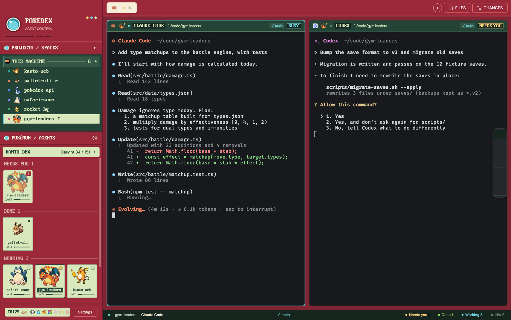

# Pokedex

A Herdr window dressed as a handheld Pokedex. The left side is a red device housing: a blue camera sensor and the word POKEDEX at the top, a dark green screen listing your projects, and below it a stack of pale LCD cards, one per coding agent. Each card shows the Pokemon that belongs to that agent's project. The Pokemon bobs while the agent works, pulses when it needs you, sparkles when it's done and sleeps when idle. On the right, your terminals sit in rounded cards on a deep red body under a red tab bar, with a dark status strip along the bottom. It's also a game: your party's lead levels up and evolves as agents finish tasks, each project shows a mascot, wild Pokemon appear, and a trainer card tracks badges and a daily streak. Everything is drawn natively by Herdr (GPUI elements described from JavaScript). There's no HTML or web view anywhere.

## What you see

The window has no system title bar. On macOS the window buttons sit at 12, 16 px over the top left of the sidebar. The whole window is a row: the sidebar (300 px, resizable from 76 to 440 px), a 3 px `#641b2b` divider, then the work area. The base housing color is `#9b293a`.

**Sidebar, top to bottom**

1. **Brand plate (124 px).** Red `#9b293a` with a 2 px `#e8797d` line underneath. Dragging it moves the window. On the left is a 46 px round sensor: a `#641b2b` bezel, a cream `#f7eed7` ring, a `#298eaa` ring, a cyan `#71d5df` lens and a small `#edffff` glint. Beside it, "POKEDEX" in the pixel font (PxPlus IBM VGA 8x16, 23 px), with "AGENT CONTROL" below it in 10 px semibold `#f3bfba`. Three 7 px lights sit at the top right: yellow `#ffcc67` while any agent is blocked, cyan while any is working, and dark `#6e2930` otherwise. The third light is always LCD green `#d9e8bc`. Under them runs a row of three short `#641b2b` bars (84, 20 and 20 px). The rest of the console text uses Geist.
2. **Projects (weight 1.5, min 120 px).** A 36 px red header strip: a small cyan lens dot, "PROJECTS / SPACES" in cream pixel type, and a "+" on the right. Below it is a dark green screen (`#244438`). Each machine gets a heading band (`#355746` with a 2 px cyan left edge): a monitor or server pixel icon, the machine name in caps ("THIS MACHINE" for this computer), a thin rule, a space count and a "+". Spaces are 28 px rows (26 px for worktrees) with a 6 px colored square, the project's mascot Pokemon (its sprite at 32 px in a 24 px window that crops the art's margin; read from `pokedex.projects` and `pokedex.partners`; worktree rows keep their branch icon instead), the name in 16 px pixel type on the whole line, a dim "#1", "#2" after spaces of one machine that share a name, and a "!" (blocked) or "*" (done) mark. At the row's right end only ahead in LCD green (↑2) and behind in `#ffd3a8` (↓1) show. The row's tooltip has the rest: name, folder (with `~` for home), repo and branch, ahead and behind. The active space is an LCD green row with dark ink and a cyan left edge. Worktree spaces sit under their main checkout with a branch icon.
3. **Agents (weight 1, min 160 px).** A red header strip with the lens dot, "POKÉMON / AGENTS", and a sort icon on the right. Under it, on the red housing, are group labels in pixel caps (`#f7eed7` at 70%) with a count and a rule to the edge, then LCD cards at least 62 px tall (`#d9e8bc`, 1.5 px border, 4 px corners) with 5 px between them. Each card holds:
   - a 48 px scene (faint wash, 1.5 px border, no ground strip) with the project's Pokemon sprite at 48 px, half its 96 px art. Its corner mark is "z" (idle), "!" (blocked) or "✦" (done).
   - a name line in 16 px pixel type. On the focused card it's inverted (LCD text on `#244438`). Cards carry no level: XP belongs to the party, not the project.
   - an optional task line (11.5 px).
   - a status line (10.5 px): a status mark, a bold status word (WORKING, NEEDS YOU, DONE, IDLE), the program's icon and name, the machine name for remote agents, the time since the last state change (`<1m`, `5m`, `3h`, `2d`), and a fold chevron with a count when the agent has sub-agents.
   - **Tiles (the default view).** Instead of full cards, agents show as square LCD tiles in a grid, as many columns as fit at 84 px or wider with 5 px gaps (3 at the default 300 px sidebar). A tile has the Pokemon drawn at 80 px inside a 63 px-tall window clipped to the tile width, so the art's empty margin is cropped (bobbing when working, pulsing when blocked); the status line (a dark `#244438` chip with `pokedex-spaces/art/server.svg` and the machine name, truncated at 42 px, when the agent runs on another machine; pin on hover or when pinned; "+N" when it has sub-agents; the status mark on the right) floats over the window's top corners at 3 px instead of taking a row, and the project name in 12 px pixel type (inverted when focused). A blocked tile gets a housing-red border. The tooltip carries the rest: project, "on <machine>" or "on this computer", task, status word, program, time since the last change, and sub-agent count. Click focuses the agent; right-click opens the mascot picker. The sort popup (now 240 px tall) has a View section: **Tiles** or **Cards with sub-agents** (`shared("agents.view")`), the full cards described here, which keep the sub-agent tree.
   - Sub-agents sit under their parent as 24 px LCD strips joined by tree lines: a 14 px Pokemon, the name and a status mark.
   - With no agents, a "NO DATA" card explains that agents appear when they report status, and that older versions and agents inside tmux may not.
4. **Footer (48 px).** Red with a 2 px `#641b2b` top line. It holds the trainer strip, a 26 px LCD chip filling the width: "TR<level>" in 14 px pixel type, a streak "♨<days>" (`#b4472f` when the streak is alive; while it's 0, "♨<active>/5": the active days among the last 7 toward one), then the eight badge sprites at 13 px (25% opacity when locked). While something waits on the trainer card, its words replace the streak and badges in housing red: "Choose your starter" (empty party), "New Pokedex: see what changed" (the one-time explainer), "A gift is waiting"; the compact chip shows a "!". After it is a "Settings" button (72 x 26 px, `#e8797d` border).

**Work area, top to bottom**

1. **Tab bar (48 px).** Red `#9b293a` with a 2 px `#e8797d` bottom line. You can drag the window by it. Tabs are 32 px tabs with 6 px corners, `#9b293a` with an `#e8797d` border and cream text. The active tab is cream with dark green text, a cream border and a close cross. Each tab shows its program icon, its name (ordinary unnamed tabs show their number), a spinner while working and a dot when blocked or done. A zoomed tab gets " Z" after its name. On the right are a round 26 px "+", then FILES and CHANGES buttons (white when their panel is open). On Linux and Windows, minimize, maximize and close buttons come last. On macOS the bar leaves room for the traffic lights when the sidebar is narrow.
2. **Body.** A `#812535` row with 10 px padding and 10 px gaps. Terminal panes are cards with 8 px corners, a 2 px `#4c302d` border that turns cyan `#71d5df` on focus, and 14 x 12 px terminal padding. They're framed even when a tab has only one pane. Each pane has a 34 px dark green header: the program icon, a 6 px dot (cyan when focused), the name in caps on a `#17251f` chip, the folder (with `~` for home) in Pixelated MS Sans Serif 11 px, and a status badge (BUSY, NEEDS YOU, DONE, IDLE) in the theme's status color. A 368 px side panel (280 to 900 px) on the right shows Herdr's Files or Changes. It's hidden until opened.
3. **Status strip (30 px).** Dark `#17251f` with 11 px `#b6c6b8` text: a cyan dot, the active space's name, the focused agent's program, then counts that only appear when they're nonzero: "Working N" (cyan), "Needs you N" (`#ffd07a`), "Done N" (LCD green) and "Idle N" (`#b6c6b8`). Before the counts sit the game chips: "Tall grass N/5" (`#ffd07a`, only while wild Pokemon wait; click opens `pokedex-encounter`), "Alert smart|on|off" (click cycles) and "Hard on|off" (click toggles), each set through the server's `setOption`. It ends with "HERDR / FIELD SYSTEM" in `#819788`.

**Theme.** The layout sets no theme of its own, so the person's theme still applies. It only overrides colors: canvas `#17251f`, chrome `#9b293a`, accent and working `#71d5df`, blocked `#ffd07a`, done `#b9dc92`. Pane backgrounds use the theme's `background`.

**Compact rail.** Under 160 px the sidebar becomes a rail. The sensor shrinks to 32 px and the title goes. Spaces and agents become 32 x 26 px numbered cells. Agent cells show a state mark in housing inks: a cyan spinner, "!" in cyan, "*" in cream, "·" for idle. The footer shows only the "TR<level>" chip, and a "»" at the bottom of the agents list widens the sidebar again.

## How it behaves

**Agent statuses** come from Herdr's reported status (OSC 7501). Agents that don't report show up only as ordinary terminals.

- **Working:** the sprite bobs 3 px over 1 s, the card shows a spinning ring and WORKING, the brand plate's cyan light comes on, and the pane badge reads BUSY.
- **Blocked (needs you):** the sprite pulses between 55% and 100% opacity over 0.8 s, with a red "!" in the corner and a red "!" chip next to NEEDS YOU on the card. The yellow brand light comes on and the space row shows "!". Sub-agent strips use a "!" chip in Priority view and a NEEDS YOU chip in Grouped view.
- **Done:** a "✦" sparkle, a filled dot and DONE. The space row shows "*". Herdr turns it to idle once its tab is shown, but the Agents tiles keep DONE until that agent's pane gets the keyboard (a finish watched in its own pane stays DONE until you leave and come back, or click it); working or needing you again ends it. The holds are kept in the mod's localStorage under `held`.
- **Idle:** a "z" over the sprite, an empty ring and IDLE in softer ink.

A sub-agent reporting `error` counts as blocked. A sub-agent never shows done: its parent carries that news. A parent sorts by its most urgent sub-agent.

**Pokemon per project.** Only Gen 1 (#001 to #151) is used. A project's mascot (cosmetic: it earns nothing) is `shared("pokedex.partners")[spaceName]` if set. Otherwise it migrates from the older 40-entry pool: FNV-1a of the space name plus its old step count picks a legacy id; ids up to 151 are kept and later ones become `hash % 151 + 1`. Clicking a scene (tooltip "No. 025 · Click to choose this project's mascot from your catches; right-click to open the collection") opens `pokedex-collection` as a 700 x 560 mascot picker with props `{project, partner}`: title "CHOOSE MASCOT · <PROJECT>", only caught Pokemon, no All/Caught filters, the current mascot outlined in housing red with a MASCOT tag. Clicking another card sets `pokedex.partners[project]` and closes the dialog. Uncaught Pokemon can't be chosen. Stones moved to the trainer card's party rows. Right-click opens the collection on that Pokemon.

**Kanto collection.** The `KANTO DEX` button ("151" in the compact rail) shows `Caught N / 151` and opens `pokedex-collection` as an 820 x 680 dialog: title, progress bar, search by name or number, All and Caught filters, and a grid of cards (#id, 48 px sprite, name; caught cards are filled with a check mark). Cards are not clickable and there is no catch button. Catches happen in the wild (`pokedex-encounter`) and by evolution. The commands below ask the server's `release` action and, for `catch-<n>`, its debug-only `catch` action: the server refuses it unless it was started with `POKEDEX_DEBUG=1`, and the dialog shows that error. The caught list is sorted unique ids in `pokedex.caught`, read from Herdr's mirrored `shared("pokedex.caught")`. The mod's `nextCommand()` accepts `catch-<n>`, `release-<n>`, `show-all`, `show-caught`, `search-<text>`, `focus`; ids outside 1 to 151 are refused with a message and change nothing. Commands reach only an open copy.

**The Pokedex agents server.** The game is not played in Herdr. [pokedex-agents-server](https://github.com/anthonymq/pokedex-agents-server) (Bun, `127.0.0.1:7151`) holds the rules and the save, and pokemon-rex uses the same server, so both apps play one save. `mods/pokedex-agents/server.js` is the client: `call(action, ...args)` POSTs `{ action, args, origin: "herdr" }` to `/call`, and `send()` is the same call when a failure only needs logging. `mirror(cx)`, run by one `pokedex-agents` copy per build, follows `/ws` (Herdr's `fetch` can't read a stream; its `websocket` module can). It writes the save's `pokedex.game`, `pokedex.caught`, `pokedex.partners` and `pokedex.projects` into Herdr's shared state when they change, so every mod reads them with `shared()` and `game()` as before, and it shows with `notify()` the news whose `origin` is `herdr`. When the server can't be reached, the mirror starts it from `$POKEDEX_SERVER_DIR`, `~/.local/share/pokedex-agents-server` or `~/workspace-perso/pokedex-agents-server`. On its first connection it merges the save Herdr kept on its own into the server's save, once, and nothing is mirrored until that merge succeeds.

**Gamification.** The rules live in the server's `game.js`; the mods keep copies only for its read-only helpers (`progress`, `levelOf`, `throwRate`, `BADGES`, ...). State is `pokedex.game` (save version 4): `{ party: [ids] (the first leads), pokemon: {id: xp}, lifetime, bank (XP earned before the starter), gifts: {got, pending}, results: {project: [kinds]}, seen: [keys], tasks, subtasks, evolutions, streak: {last, days, best, freezes, active}, badges: [ids], shiny: [ids], wild: [{id, at, balls, weak, project}] (the tall grass, oldest first; `encounter` mirrors its head), encounters: {seen, caught, fled}, recent: [{id, at}] }`.
- **Project keys.** Per-project state (mascot, results, fainting) is keyed by the space's git repo root (`git rev-parse --show-toplevel` in the live folder of the space's first terminal, from `panes()[i].cwd`, run once per space name on the space's machine; `<machine>:<path>` when remote). Never `spaces()[i].folder`: that is where the space was created, and many spaces share it, which would merge their progress. A space with no terminal folder yet, or whose git call can't run, is retried on a later render, else the space name. `shared("pokedex.projects")` maps space name to key; `projectKey(name)` reads it. When a key resolves, existing progress under the name moves to it (`migrateProject`), so renaming or recreating a space keeps its mascot. Labels show the key's last path segment.

- **XP.** When an agent's status goes from working to idle or done (done and idle count as one), the party's lead gets 10 XP plus 5 per full minute the turn ran, up to 50, whatever the project, and the rest of the party gets 25% (Day Care). The day's turns 1-5 pay in full, 6-20 40%, 21-50 10%, then 3%. XP before a starter is chosen waits in `bank`. Results pay on top, once per kind per turn and project: +20 commit, +30 green, +50 merged plus an Ultra Ball. Herdr reports only commits: when an agent's turn starts (it goes working, except a resume from NEEDS YOU) the mod runs `git rev-parse HEAD` in the agent's pane folder on its space's machine (3 s timeout, off the render path, guarded by `checking()`); after sending `taskFinished` it reads HEAD again and, when it moved to a descendant of the old one (`git merge-base --is-ancestor`), sends `result(project, "commit")`. Errors and non-git folders report nothing. It has no cheap, reliable signal for green tests or merges, so it never sends those. A sub-agent without its own pane that goes from working to idle or done earns 10 XP (no streak day, no encounter); kept sub-agents earn like agents. Only the agents mod awards XP. It's counted only while Herdr is open.
- **Levels.** Level n needs 4·n² XP (Lv16 at 1024, Lv36 at 5184, Lv100 at 40000), from Lv1 to Lv100: a first evolution takes roughly 30-50 real tasks. A level-up posts a toast "<Name> reached Lv <n>!" (with the Pokemon's sprite) only when it crosses a multiple of 5, so a new project's first hours aren't a stream of toasts.
- **Evolution.** At its Gen 1 level a party member evolves (Charmander 16, Charmeleon 36, Magikarp 20, Dratini 30, Dragonair 55...). Stone and trade evolutions need the item, used on a party member (`useItem(id, item)`). The new form keeps the XP, replaces it in the party, is caught, a toast says "What? <Name> is evolving!", and `mods/pokedex-agents/sounds/evolve.mp3` plays (a 1.5 s climbing square-wave arpeggio, generated for this package).
- **Active-day streak.** A day is active when at least one task finished, and it keeps the streak when 5 of the 7 days ending with it were active, so any two days off a week are fine; the streak counts those days and a third day off resets it to 0. A Streak Freeze, earned every 7 active days (2 at most), covers a missing day that would break it. The best streak is kept. The trainer card shows "<n> days", or "<active>/5 days this week" until a streak starts.
- **Shinies.** Every new catch has a 1 in 8 chance to be shiny at a 7-day streak and 1 in 4 at 30 days. Shiny cards in the collection get a 2 px gold `#e8c35a` border and a "✦ SHINY" tag.
- **Wild encounters.** Each finished task has a 15% chance (while fewer than `WILD_MAX` = 5 wait) to add a random Gen 1 Pokemon to the tall grass, where it waits `ENCOUNTER_MS` = 24 h; never a legendary, and 40% of them are species not caught yet. Legendaries come from milestones (`summon`): a bird after three weekly quests in a row at Bronze, Mewtwo at Champion, Mew once the other 150 are caught; they wait at the front of the queue (`staying`), never flee, and catch at 35%. The layout's root sets `"toast": "pokedex-toast"`. Ordinary notifications look like Herdr's own toast. The mirror never shows notes marked `quiet` (level-ups, items, quests), and shows an encounter note only when `shouldAlert(busy agents)` allows it (options `alert`: smart, the default, only while no agent is working; on; off); otherwise the Pokemon just waits and the status strip counts it. An encounter (title "A wild <Name> appeared!", icon `mods/pokedex-agents/pokemon/<id>.png`) reopens itself as a 460 x 140 `kind: "window"` overlay (key `pokedex-wild`, centered, no keyboard grab) and closes the toast strip, which is too short for it. The window plays the "blocked" sound and shows a battle card: a gold frame flashing over a housing-red one, the sprite at 84 px bobbing in a cream circle, a blinking "!", "WILD POKEMON", "<NAME> APPEARED!" in 22 px pixel type, a "Throw a Poke Ball" chip and the note's body ("It's waiting in the tall grass (n/5)."). Clicking it runs `mod.open pokedex-encounter`; × dismisses it; it closes itself after 15 s. Evolution toasts carry the new form's sprite as their icon. A Pokemon left past 24 h counts as fled. The 360 x 540 encounter dialog shows "TALL GRASS n/5", a row of 46 px cells (one per waiting Pokemon, the chosen one framed; shown when more than one waits), then the chosen Pokemon (the oldest by default) bobbing, its catch rate and its 3 Poke Balls plus the bag's Great and Ultra Balls: 60% for basic and middle forms, 35% for final forms, 3% for legendaries, +25% per weakening. Throws and "Run" pass the chosen Pokemon's queue index to `throwBall(ball, index)` and `runAway(index)`; a throw says Gotcha!, broke free or fled, and "Next: <Name>" moves on to the next one waiting.
- **Gyms.** Eight gyms (`GYMS`), one open at a time, each badge announced by a toast and `sounds/badge.mp3` (a 1.3 s fanfare; skipped when an evolution jingle just played). A gym's options are counted from the day it opened, sized to the player's median when it opened; `gymNow(g)` (the server's `view.gym`) gives the open gym, the Elite Four member of the week (`LEAGUE`) or the Hall of Fame, and the trainer card draws it under the quests. Task counts are side medals (`MEDALS`); badges from before save version 6 are Classic medals.
- **Jingles.** Both play through `playSound` and stay silent when settings.json has `"sounds": { "enabled": false }`. They are original synthesized tones, not game audio.
- **Trainer card.** Clicking the footer strip opens `pokedex-trainer` as a 600 x 640 dialog: the one-time NEW POKEDEX explainer (three steps: one party with XP to the lead wherever you work, projects keep their Pokemon as mascots, trainer level from lifetime XP with gifts at 5/10/15/20/30; "Got it" calls `seen("phase2")`; shown when `lifetime > 0` and `seen` lacks "phase2"), CHOOSE YOUR STARTER while the party is empty (Bulbasaur, Charmander, Squirtle as 72 px cards; `chooseStarter`; the banked XP is named), one panel per waiting gift with its choices (`claimGift(tr, id)`), then TRAINER LV (`trainerLevel(g)` = floor(sqrt(lifetime / 40)), with lifetime XP and the next level's threshold 40·(n+1)²), CAUGHT n/151, TASKS ("<n> + <m> sub"), STREAK ("<n>d (best <m>)"); a second row ENCOUNTERS, CAUGHT IN WILD, FLED and CATCH RATE; RECENT CATCHES, the last ten as 42 px sprite cells (gold-framed when shiny); the badge row (the real Kanto badge art at 36 px, 25% opacity when locked, goal in a tooltip), and PARTY n/6: each member's sprite, name, LEAD (outlined in housing red) or DAY CARE 25%, XP bar and total, Lv, a button per usable stone (`useItem`) and "Lead" (`setLead`). "Change party" opens `pokedex-collection` with `{party: true}`: "CHOOSE YOUR PARTY", caught only, LEAD/PARTY tags, a click adds a catch at the end or takes a member out (`setParty`, 1 to 6). Everything under the header scrolls.

**Agents list.**
- Clicking a card focuses its pane. Clicking a sub-agent strip focuses it if it has a pane, and otherwise peeks at it.
- Hovering a card reveals a pin. It pins the agent to the top of every agent list across connected Herdr clients, or unpins it.
- The sort icon opens a small popup: **Priority** (the default) groups cards under Needs you, Done, Working and Idle, newest change first. **Grouped by space** puts them under each space's name. Pinned agents always come first, under "PINNED".
- Clicking a group label folds it. Folded, it shows its count, its most urgent mark and a chevron. The chevron on a card folds its sub-agents.
- The Idle section (Priority sort) never folds. With more than 6 idle agents (`IDLE_FEW`) it shows 38 px LCD cells holding only the sprite (44 px art, cropped), 5 px apart; the tooltip carries the tile's details, click focuses, right-click chooses the mascot. With 6 or fewer it shows the usual tiles or cards. Clicking its label shows the other form until the count crosses the threshold again.
- The list sets Herdr's agent order, so next agent and previous agent follow it.
- Time-since labels refresh every 30 s.

**Projects list.**
- Clicking a space switches to it. Dragging one onto another in the same machine reorders them, with a cyan line marking where it will land. Right-click opens Herdr's space menu, which includes the worktree actions.
- The header "+" makes a new space. A machine's "+" makes one on that machine. A machine heading folds and unfolds. A machine that was rebuilt offers "Connect".
- Worktree spaces move under their main checkout by themselves.
- Git info refreshes when a command or agent turn ends, when the repo changes on disk, and every 60 s for visible repos while the window is in front.

**Brand, footer and status.** Clicking the sensor opens the command palette (tooltip "Open command palette"). The trainer strip opens the trainer card. Settings opens Herdr's Look settings. Clicking a count in the status strip focuses an agent in that state (`agent.focus`); repeated clicks walk through them.

**Tabs.** Click to select a tab, double-click to rename it, drag to reorder it, right-click for its menu. The close cross closes the active tab. Scrolling the wheel over the bar moves to the previous or next tab, and the bar scrolls to keep the active tab in view. "+" opens Herdr's new menu (terminal or any installed agent). FILES and CHANGES toggle the side panel, and each space remembers which panel it had open. When a command prefix is armed, the active tab's border turns cyan.

**Panes.** Clicking a header focuses its pane. Hovering a header shows split right, split down, zoom (unzoom when zoomed) and close.

**Movement.** Sprite bobbing, pulsing and the spinners are native animations, not timers. You can drag the sidebar edge, and the side panel resizes too.

## Built from

- **`layouts/pokedex.json`.** Root `row` with `titlebar: "none"`, `traffic_lights: [12, 16]`, `preview: "layouts/pokedex.svg"`, `background: "#9b293a"`, the `colors` above, `terminal_padding: [14, 12]` and a 3 px `#641b2b` divider. Tree:
  - `sidebar` column (300 px, min 76, max 440, `#9b293a`):
    - `brand` block, 124 px, `window_drag`, mod `pokedex-console` with props `{ role: "brand" }`
    - `sidebar-lists` column (3 px `#641b2b` divider):
      - `spaces` block (weight 0.9, min 120), mod `pokedex-spaces`
      - `agents` block (weight 1.4, min 160), mod `pokedex-agents`
    - `sidebar-footer` block, 48 px, `pokedex-console` with `{ role: "footer" }`
  - `work` column, `resizable: false`:
    - `tabs` block, 48 px, `window_drag`, mod `pokedex-tabs`
    - `work-body` row (padding 10, gap 10, `#812535`):
      - `main` block, `{ tab: "active" }` with the pane frame: gap 10, radius 8, background `background`, border 2 `#4c302d`, focus 2 `#71d5df`, header mod `pokedex-pane` (34 px, top, always), `lone: true`
      - `panel` column (hidden, 368 px, 280 to 900) holding `panel-body`, a `stack` (active `files`) of `files` and `changes` blocks using Herdr's shipped mods
    - `status` block, 30 px, `pokedex-console` with `{ role: "status" }`
- **`layouts/pokedex.svg`.** The settings preview.
- **Nine mods** (`pokedex-toast` draws notifications for this layout). All have `place: "none"`. Herdr refuses imports from another mod's folder, so each mod that plays keeps identical copies of the server's `game.js` (read-only helpers) and `pokemon.js` (names), and of `server.js` (the client): `pokedex-agents`, `pokedex-console`, `pokedex-collection`, `pokedex-trainer` and `pokedex-encounter`.
  - `pokedex-trainer` is the trainer card dialog (`mod.json` overlay dialog 560 x 520). It holds `badges/` with the eight Kanto badge PNGs (`boulder.png` to `earth.png`, 75-85 px, from the PokeAPI sprites repository `sprites/badges/1-8.png`); the console strip reads them from there too. It reads `pokedex.game` and `pokedex.caught`, and calls `chooseStarter`, `setLead`, `useItem`, `claimGift` and `seen`.
  - `pokedex-encounter` is the wild encounter dialog (`mod.json` overlay dialog 360 x 540), opened by `mod.open` from the status strip's tall grass chip or the encounter toast. It never opens by itself. It asks the server's `throwBall` and `runAway` actions with the chosen Pokemon's index, one ball in flight at a time, and shows the server's error if it can't be reached.
  - `pokedex-console` draws three roles from `props().role`: `brand`, `footer` and `status` (it defaults to brand). It reads `agents()`, `spaces()`, `focused()` and the game state, runs `app.palette` and `app.settings {section: "look"}`, and opens `pokedex-trainer`. It measures its own width with `on_size_change` and goes compact under 160 px. Its `nextCommand()` takes `alert-off`, `alert-on`, `alert-smart`, `hard-mode-on` and `hard-mode-off` (each a fixed `setOption`, so every shown copy can run it).
  - `pokedex-spaces` was cloned from Herdr's spaces mod (via `retropet-spaces`). It uses `spaces()`, `machines()`, `panes()`, `window()`, `layout()` and `shared("space.colors")`. It runs `exec("git", ...)` (`status --porcelain=v2 --branch`, `rev-parse`) locally or on the space's machine, and `hc machine ls/rm/add`. It uses `watchFolder` on local repos, `space.select`, `space.move`, `space.new` and `openOverlay` of the shipped `menu`. Its timers run at 250 ms (cheap change check) and 15 s (machines). It holds `fonts/` and `art/` (`monitor.svg`, `server.svg`, `dither.svg`).
  - `pokedex-agents` was cloned from `retro-agents`. It uses `agents()`, `terminals()` (sub-agent trees via `parent`), `panes()`, `spaces()`, `focused()` and `setAgentOrder`. It runs `pane.focus`, `terminal.peek` and `terminal.pin`. A space gets its Pokemon only when an agent opens in it: the mod saves the default mascot for each agent's project that has none (so every view agrees). The hashed default goes through `defaultPartner()` (a base form, never a legendary), as the server's `savePartners` does. Spaces with only shells have no partner, and the spaces list and picker show their plain colored marks. It reports what its status tracking sees to the server (`taskFinished`, `result` for commits, `subTaskFinished`, `unblocked`, `savePartners`, `resolveProject`) and runs the mirror. It reads `pokedex.partners`, `pokedex.caught` and `pokedex.game` from the mirror. Its own shared keys: legacy `retro-pokemon.steps`, `sidebar.width` and `sidebar.collapsed`. It calls `layout.resize` on `sidebar` (76 px, or back to the saved width, default 300). It opens itself as a 200 x 140 popup with `{ sortMenu: true }`. Its localStorage keys are `changed` (state timestamps, pruned after 30 days) and `pins`. It holds `pokemon/` with 151 PNG sprites (1.png to 151.png, 96 x 96, from the PokeAPI sprites repository).
  - `pokedex-tabs` was cloned via `retropet-tabs`. It runs `tab.select`, `tab.move`, `tab.rename`, `tab.close`, `tab.prev` and `tab.next`, plus `layout.select/show/hide` on `panel-body` and `panel`, and the `window.*` commands. It opens the `new-menu` popup (250 x 512) and `menu`. It reads `shared("workspace.panels")` (default files and changes) and stores each space's panel in localStorage `panels`. It uses `ScrollHandle` and holds Windows window icons (`win-min`, `win-max`, `win-restore`, `win-close`).
  - `pokedex-pane` was cloned via `retropet-pane`. It reads `panes()` and `home()`, runs `pane.focus`, `pane.split`, `pane.zoom` and `pane.close`, and holds `split-right`, `split-down`, `zoom`, `unzoom` and `close` SVGs.
  - `pokedex-collection` is new: `main.js`, `mod.json` (`focusable`, overlay 820 x 680) and `pokemon.js`, a static `POKEMON` array of 151 `{id, name}` records (names such as Nidoran F, Nidoran M, Farfetch'd, Mr. Mime). It uses `shared`, `props`, `closeOverlay`, `nextCommand`, `InputState`/`Input`, and reads sprites from `mods/pokedex-agents/pokemon/`. It changes the game only through the server: `catch`, `release`, `setPartner` and `setParty`. Its dex entries name `how`: wild, evolved, met, starter, gift (trainer gift) and partner (a project's partner before the party).
- **Fonts.** Three files in `mods/pokedex-spaces/fonts/`: `PxPlus_IBM_VGA_8x16.ttf`, plus `PixelatedMSSansSerif-Regular.ttf` and `-Bold.ttf`. Their notices are `LICENSE-PxPlus.txt` (CC BY-SA 4.0) and `LICENSE-MSSansSerif.txt` (lou 2017, FontStruct, CC BY-SA 3.0). Herdr loads them at start, and every mod uses them by family name.
- **Shipped Herdr dependencies, not packaged:** `files`, `changes`, `menu`, `new-menu`, `worktree` (reached through the menus), Geist, and `workspace-chrome` icons (`spinner`, `chevron-down/right`, `pin`, `pin-off`, `clock`, `layers`, `check`, `plus`, `branch`, `monitor`, `server`). It also uses `mods/pane/close.svg`, `mods/files/file.svg` and `mods/changes/changes.svg`.
- **`programs.json`.** Merge entries for `omp` (name "OMP", tile `#f3a9bd`, `run: ["omp"]`) and `omo` (name "OMO", tile `#71d5df`, `run: ["omo"]`). Both use `personal-icons/retro-agent.svg` with `tint: false`. Claude Code and Codex use Herdr's built-in entries. Agent identity is generic: a card names the program from Herdr's table, and falls back to the agent's reported `app` when the table doesn't know it.
- **Keys.** `keys.json` has only a `layout:pokedex` section binding cmd-p, cmd-s, ctrl-a ctrl-a and ctrl-a a to `mod.open:pokedex-picker`, and cmd-e, cmd-j, cmd-shift-j and cmd-shift-k to `pokedex-alerts.focus`, `.next-needy`, `.peek` and `.pin` (the alert drawer floating on `work-body`'s right edge; focus flips the `view` stack between `main` and the `focus` agent block); merge it, keep the person's other bindings.
- **`pokedex-picker`.** A `mod.clone` of Herdr's shipped `picker` (the Go to… popup). Changes: results are one line per tab, with no space title rows. Each 32 px row is the status mark, the space's partner Pokemon (28 px art in a 22 px box that crops its margin; a space without a saved partner keeps the colored 18 px letter square), the space name in semibold, then the tab name (muted, semibold and bright for the tab you're on), any "needs you"/"finished" word and the agents. Search, arrows, Enter, ctrl-d and the "earlier" fold work as in Herdr's picker. When the typed text matches no tab or space, the picker acts like zoxide: it runs `zoxide query --list -- <words>` (local, 3 s timeout; an answer for older text is dropped) and offers up to five "+ new space in <folder>" rows, best first and the first selected (`~` shown for home). With no zoxide match, or zoxide missing, a single "+ new space <text>" row ("new space in <path>" for a typed `~/…` or `/…`) offers one instead: Enter or a click runs `space.new` with `{ folder }` for a zoxide or typed path, else `{ name: text }`, with `~` expanded via `home()`, and Herdr shows the new space. Being a clone it doesn't receive Herdr's later picker updates.
- **Status protocol.** Programs report through [OSC 7501](https://www.superlogical.com/rex/docs/build/program-status): colon-separated `key=value` pairs, not JSON; `state` is required, `app` identifies the program, and `msg`/`title` are base64 UTF-8. For example, `ESC ] 7501 ; state=working:app=codex ST`. Herdr exposes the parsed state as `a.status`; the layout reads it rather than guessing from terminal text.
- **Reusing the art.** The exact sprites and font files are included at their paths in this repository. A rebuild in an empty folder can reuse those assets from [pokemon-herdr](https://github.com/anthonymq/pokemon-herdr), retaining the font notices. Build the native UI from this brief; do not substitute the screenshot for working elements.

## Watch out

- Mods can't import across folders (`resolves outside the application directory`). Edit the rules in pokedex-agents-server and the client in `mods/pokedex-agents/server.js`, then run `scripts/sync-game.sh`. It reads the server repo from `$POKEDEX_SERVER_DIR`, else `../pokedex-agents-server`. `scripts/sync-game.sh --check` exits 1 and names any copy that differs.
- Never change the game with `setShared` in a mod: the mirror overwrites it, and the other app never sees it. Deploy server changes before the mod changes that use them. Herdr reloads a mod the moment its file is saved, so a mod can call an action the running server doesn't have yet.
- Cards use `min_h(62)`, not a fixed height: a card with a task line needs about 66 px, and a fixed 62 px pushed the bottom line over the border. Padding is 5 px and text-column gaps 1 px.
- Game state, like caught progress, is personal state in the server's `~/.local/state/pokedex-agents-server/` and in Herdr's mirrored `shared.json`; never publish it.
- Herdr's shipped mods are read-only. Build the eight mods under these new names, and don't edit `spaces`, `agents`, `tabs` or `pane` in place.
- Every mod decides compact mode from the `sidebar` node's `size.px` (under 160) in `layout()`, not from a flag. The console uses its own measured width instead. Keep the node id `sidebar`, plus `panel`, `panel-body`, `files` and `changes`, which the tabs mod drives by id.
- Fonts are referenced by family name and loaded from `pokedex-spaces/fonts`. Keep that folder, or the pixel type falls back. The comment in `pokedex-pane` mentions `retropet-spaces/fonts`, which is stale.
- Mascot choices are keyed by project, so a space without a resolved key can change its Pokemon when renamed. Caught progress is personal state (see above); never publish it.
- Keep the legacy 40-id migration list unchanged, or existing projects get different mascots.
- `herdr-app check` covers the first render only. The sort popup, hover pins, sub-agent rows, folded groups and machine states need a look in the running app.
- Agents inside tmux, and older agents, may not report status and won't appear as cards.
- Don't put Pokedex or POKEDEX with an accented e in user-facing text. The agents header does read "POKÉMON / AGENTS".
- The footer has only the trainer strip and Settings. Earlier builds had an "Original" button and pane-focus arrows there, and both were removed. Don't add them back.
- Normal tabs display their names or ordinal numbers. Only a legacy name matching `tb` followed by digits is replaced by the program name; do not assume all unnamed tabs show the program name.
- Herdr regenerates `gpui-kit.d.ts`, `herdr.d.ts` and `jsconfig.json` in each mod. Leave them out of the package.
- The sprites and Pokemon names are third-party artwork. This package grants no rights to them.

## Done when

- `scripts/sync-game.sh --check` passes; `.github/workflows/check.yml` checks out pokedex-agents-server beside this repo and runs it on every push and pull request. The rule tests (XP, levels, level news, project keys, evolution, jingles, badges, sub-agents, encounters, merge, the HTTP and WebSocket API) pass with `bun test` in pokedex-agents-server.
- With the server running, finishing an agent task in Herdr raises the XP in Herdr and in pokemon-rex, and the Herdr toast for it shows only in Herdr. With the server stopped, Herdr starts it within a few seconds.

- `herdr-app check` passes for `pokedex-console`, `pokedex-spaces`, `pokedex-agents`, `pokedex-tabs`, `pokedex-pane`, `pokedex-collection`, `pokedex-trainer` and `pokedex-encounter`.
- An agent going working then idle adds XP to the party's lead (25% to the rest): the trainer card's party bars move and TASKS goes up by one. A turn that commits in a git repo adds the commit result.
- `herdr-app do mod.open --name pokedex-trainer` shows the four stats, eight badges and the party (or the starter choice on an empty save); clicking the footer strip opens the same card.
- With wild Pokemon waiting, nothing opens by itself; the status strip shows "Tall grass N/5" and opens `pokedex-encounter`, which lists them; picking one and three misses make that one flee, a catch adds it to the collection. With `pokedex-console.alert-on` a new one flashes the battle card; with `alert-smart` only while no agent is working.
- Every sprite is Gen 1; `herdr-app do mod.open --name pokedex-collection` then, against a server started with `POKEDEX_DEBUG=1`, `pokedex-collection.catch-25` twice and `catch-151` saves `[25,151]` (without it the dialog shows the server's refusal); `release-25`, `release-151` empty it; `catch-0` and `catch-152` change nothing; the list survives an app restart.
- `herdr-app do layout.switch --name pokedex` shows the red sidebar with POKEDEX, PROJECTS / SPACES, POKEMON cards with mascots, and a footer with the trainer strip and Settings.
- Clicking the sensor opens the palette, and Settings opens Look settings.
- An agent that reports working, blocked, done and idle shows each animation, word and mark, and the status strip counts change to match.
- Clicking a Pokemon scene changes the sprite for every agent in that space, and a project keeps its mascot after a restart.
- Priority and Grouped sorts both work. A pin moves a card under PINNED, and sub-agents appear in a tree under their parent.
- Dragging the sidebar under 160 px gives numbered rail cells, and "»" brings back the previous width.
- FILES and CHANGES open the side panel, and switching spaces restores each space's choice.
- Hovering a pane header shows split, zoom and close, and they act on that pane.
